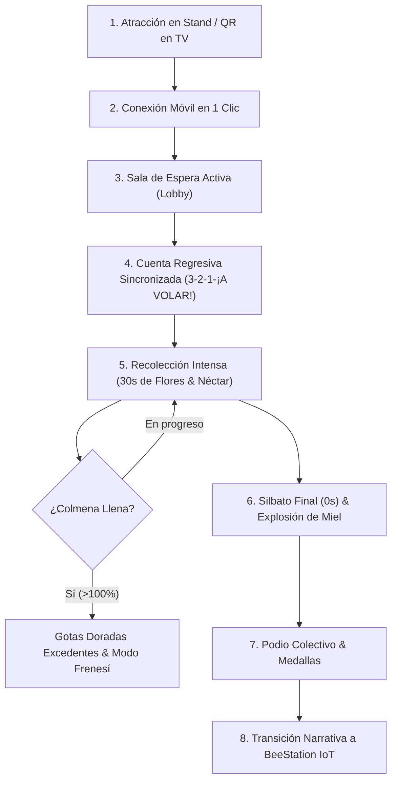

# GAME DESIGN DOCUMENT (GDD)
# BeeStation: Misión Néctar

**Versión:** 2.0 (Diseño Integral Antigravity)  
**Género:** Videojuego Arcade Casual, Familiar, Cooperativo y Multijugador en Tiempo Real  
**Plataformas Objetivo:** Pantalla Central TV 16:9 (Espectador/Mundo Colectivo) + Smartphones Móviles Web (Controles Táctiles Individuales) + Consola Organizador  
**Público Objetivo:** Niños (desde 5 años), jóvenes y adultos en ferias científicas, exposiciones ambientales y eventos educativos SENA.  
**Tiempo de Partida:** 30 segundos exactos (alta rotación en eventos, adrenalina inmediata).  
**Premisa Central:** Cooperación pura. No hay respuestas incorrectas, ni trivias excluyentes, ni penalizaciones. Cada participante suma al gran tarro de miel colectivo.

---

## 1. VISIÓN CREATIVA Y NARRATIVA

### 1.1 El Conflicto
El **Jardín Mágico de BeeStation** ha tenido un ciclo de sequía energética y necesita la colaboración de un enjambre solidario para volver a florecer. Mielita, la abeja líder y guardiana del jardín, convoca a los visitantes del stand o feria a unirse como abejas exploradoras.

### 1.2 El Llamado a la Acción (Under 5 Seconds Rule)
Cualquier persona que pase frente a la pantalla de televisión gigante debe entender en menos de cinco segundos de qué trata la experiencia y cómo participar:
> **"¡ESCANEA EL QR CON TU CELULAR, TOCA LAS FLORES QUE BRILLAN Y AYUDA A LLENAR LA COLMENA EN 30 SEGUNDOS!"**

### 1.3 La Conexión con el Mundo Real
El juego no es fantasía aislada: celebra la labor polinizadora vital de las abejas (*Apis mellifera* y meliponinos). Al terminar la partida y celebrar la victoria colectiva, Mielita se vuelve hacia los jugadores y plantea la pregunta puente:
> *"¿Y cómo sabemos qué ocurre dentro de una colmena real sin dañarla?"*  
Aquí el juego conecta con la tecnología **BeeStation**: monitoreo no invasivo IoT desarrollado con ESP32, donde la recolección virtual se enlaza con mediciones de peso, temperatura, humedad y actividad acústica.

---

## 2. PILARES DE DISEÑO DE JUEGO (DESIGN PILLARS)

1. **Inclusión Instantánea (Zero-Friction Onboarding):**
   - Entrada mediante QR sin descargas de app stores, sin contraseñas ni registros invasivos.
   - Si el jugador no elige personaje o apodo, el sistema asigna automáticamente una abeja y un nombre simpático ("Abejita Veloz", "Rayo Miel", etc.) en 1 toque.
2. **Colectividad sobre Competencia:**
   - La victoria es del grupo. El objetivo principal es alcanzar el 100% de la capacidad de la colmena (45 a 100 gotas recolectadas colectivamente).
   - El rendimiento individual se premia con medallas simpáticas y mención en podio, pero nunca se expone a nadie a la derrota o al ridículo.
3. **Juice & Satisfacción Háptica/Visual:**
   - Cada toque a una flor produce una respuesta sinestésica inmediata: estallido de polen, sonido de gota de miel o carillón armónico, temblor sutil (vibración háptica en móvil), y una estela de néctar que vuela visiblemente desde la flor hacia la colmena.
4. **Legibilidad Espectacular a Distancia (TV) y Ergonomía Pulgar (Móvil):**
   - El TV privilegia la vista panorámica del jardín, la colmena gigante y el vuelo simultáneo de decenas de abejas.
   - El móvil ofrece botones táctiles amplios (mínimo 75x75 px), alto contraste y tiempos de respuesta ultra-bajos (<50 ms).

---

## 3. CORE LOOP (BUCLE PRINCIPAL DE JUEGO)

### 3.1 Duración y Fases de la Partida
- **Fase 0: Bienvenida & Lobby (Indefinida):** El TV proyecta a Mielita flotando sobre el jardín, con un código QR de gran escala y el listado de exploradores uniéndose en vivo.
- **Fase 1: Preparación / Cuenta Regresiva (3 segundos):** Cuenta 3, 2, 1 con campanas crecientes. En el móvil se muestra un micro-tutorial de 1 sola ilustración animada: dedo tocando flor brillante.
- **Fase 2: Partida Activa (30 segundos):**
  - **Segundos 0 a 10 (Inicio suave):** Flores comunes aparecen con cadencia predecible (1.2 segundos de exposición).
  - **Segundos 11 a 20 (Ritmo sostenido):** Comienzan a brotar las primeras Flores Doradas. Cadencia dinámica.
  - **Segundos 21 a 30 (Frenesí de Oro y Cierre):** El atardecer baña el jardín, aparecen racimos de flores doradas, el reloj pulsa en rojo y la música aumenta su tempo.
- **Fase 3: Celebración y Resultados (15 segundos):**
  - Animación de colmena derramando miel dorada.
  - Podio de los 3 mayores recolectores + lista de menciones de honor (más constante, explorador relámpago, etc.).
- **Fase 4: Puente Educativo BeeStation (15-30 segundos opcional / activable por organizador):**
  - Mielita introduce el panel IoT de BeeStation con los sensores reales del nodo ESP32.

---

## 4. SISTEMA DE FLORES, PUNTOS Y RECOMPENSAS

| Tipo de Flor | Apariencia | Valor Néctar | Comportamiento | Ventana de Toque | Probabilidad |
|---|---|---|---|---|---|
| **Flor Silvestre Común** | Pétalos amarillos, coral, cielo o lavanda con polen radiante | **10 Puntos** (1 gota a la colmena) | Pulsa suavemente; destellos de polen. | 2.5 segundos activa | 75% |
| **Flor Dorada Especial** | Pétalos de oro puro, aura celestial y partículas flotantes | **30 Puntos** (3 gotas a la colmena) | Rota con destellos brillantes y tintineo. | 1.8 segundos activa | 25% (sube al 40% en últimos 10s) |

### 4.1 Ciclo de Estados de una Flor
1. **Brote / Preparación (0.3s):** El tallo crece con elasticidad (*anticipación visual*).
2. **Disponible / Brillante (1.8s - 2.5s):** Brillo activo, listo para recibir toques.
3. **Recolectada (0.2s):** Partículas estallan hacia arriba; la flor suelta su néctar y se inclina feliz.
4. **Recuperándose / Cooldown (1.0s - 1.5s):** Se desvanece suavemente para dejar espacio a nuevos brotes.

### 4.2 Multiplicadores y Rachas (Combo Meter)
Para recompensar la atención táctil en el móvil:
- **Racha x2:** 3 flores recolectadas seguidas sin tocar fuera.
- **Racha x3 (¡Zumbido Dorado!):** 6 flores seguidas. Las gotas de néctar se vuelven triples y dejan estelas brillantes.

### 4.3 Capacidad Colectiva y Néctar Excedente
- La meta base de la colmena se calibra automáticamente según el número de jugadores conectados:  
  $$\text{Meta Gotas} = \max(30, N_{\text{jugadores}} \times 12)$$
- Si se llena al 100%, la colmena no se bloquea: entra en **Modo Reserva Real (Overcharge)**, donde las gotas excedentes llenan frascos de miel especiales visibles a los lados, celebrando la hiper-abundancia del enjambre.

---

## 5. ROLES DE LOS PARTICIPANTES Y EXPERIENCIA MULTI-PANTALLA

### 5.1 Pantalla Principal de Televisión (Espectador Panorámico)
- Relación de aspecto 16:9 fija con letterboxing inteligente o escala adaptativa para pantallas FHD (1920x1080), QHD o 4K.
- Renderiza el paisaje completo del Jardín Mágico en 4 capas de profundidad.
- Muestra el tarro de colmena central con física de llenado de líquido dulce.
- Muestra pequeños avatares de abejitas con los nombres de los jugadores flotando hacia las flores que van siendo recolectadas.

### 5.2 Celular del Participante (Controlador Individual)
- Formato vertical responsive (320px a 430px de ancho).
- Matriz táctil ergonómica de 6 flores dinámicas en el tercio inferior y medio de la pantalla (zona óptima del pulgar).
- Barra superior compacta con: Puntuación personal, Contador colectivo global, Temporizador circular de 30s.
- Feedback táctil instantáneo por vibración web (`navigator.vibrate([15])` en navegadores compatibles).

### 5.3 Consola del Organizador (Game Master)
- Control de estado: Iniciar cuenta regresiva, Pausar/Reanudar, Reiniciar sala, Forzar victoria, Disparar transición BeeStation.
- Inyector de Bots de prueba: permite simular desde 1 hasta 100 abejas concurrentes con ritmo configurable para verificar rendimiento visual en feria sin necesidad de reclutar 100 teléfonos reales durante las pruebas.
- Control de audio y selector de tema ferial.
