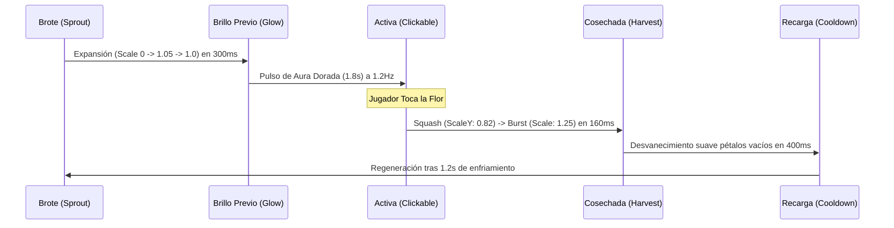

# ANIMATION AND MOTION DESIGN BIBLE
# BeeStation: Misión Néctar

---

## 1. PRINCIPIOS DE ANIMACIÓN DEL JUEGO

El movimiento en **Misión Néctar** sigue los principios clásicos de la animación tradicional adaptados al renderizado web fluido a 60 FPS:
1. **Squash and Stretch (Compresión y Estiramiento):** Al tocar una flor o al aterrizar Mielita, el volumen se deforma elásticamente sin perder masa perceptual.
2. **Anticipation (Anticipación):** Antes de soltar la gota de néctar, la flor se contrae un 8% hacia abajo durante 120ms antes de expandirse al 115%.
3. **Follow-Through & Overlapping Action (Continuidad y Solapamiento):** Las antenas de Mielita y sus alitas tienen inercia secundaria que sigue oscilando aún cuando el cuerpo se detiene.
4. **Organic Easing:** Prohibición absoluta de movimientos lineales `linear` en interfaces orgánicas. Todo desplazamiento utiliza curvas cúbicas suaves:
   - Resorte elástico: `cubic-bezier(0.34, 1.56, 0.64, 1)`
   - Desaceleración suave: `cubic-bezier(0.16, 1, 0.3, 1)`
   - Aceleración enérgica: `cubic-bezier(0.7, 0, 0.84, 0)`

---

## 2. ESPECIFICACIÓN DE RIGGING Y ANIMACIONES DE PERSONAJES

### 2.1 Ciclo de Vuelo e Idle de Mielita
```
[ Keyframe 0% ]  Y: 0px,    Alas: +35deg, Antenas: 0deg,   Sombra: Escala 1.0
[ Keyframe 25% ] Y: -8px,   Alas: -45deg, Antenas: +4deg,  Sombra: Escala 0.88
[ Keyframe 50% ] Y: -14px,  Alas: +35deg, Antenas: 0deg,   Sombra: Escala 0.80
[ Keyframe 75% ] Y: -6px,   Alas: -45deg, Antenas: -4deg,  Sombra: Escala 0.92
[ Keyframe 100%] Y: 0px,    Alas: +35deg, Antenas: 0deg,   Sombra: Escala 1.0
```
- **Frecuencia del aleteo:** 20Hz (animación CSS en bucle de 50ms) en vuelo activo; 8Hz en modo flotación suave.
- **Frecuencia de oscilación vertical (Bobbing):** 2.2 segundos por ciclo completo con curva sinusoidal pura.

### 2.2 Reacción de Toque y Recolección
- **Duración Total:** 380 ms.
- **0ms - 80ms:** La abeja vuela en picada hacia la flor con aceleración `ease-in`.
- **80ms - 150ms:** Contacto. Mielita guiña un ojo (`expression: wink`), su abdomen se inclina y absorbe la gota de néctar.
- **150ms - 380ms:** Rebote ascendente elástico hacia su posición flotante, soltando tres chispas doradas.

---

## 3. COREOGRAFÍA Y CINEMÁTICA DE LAS FLORES

### 3.1 Transición Brote -> Activa -> Cosechada


### 3.2 La Flor Dorada Especial (Golden Lotus)
- **Aura:** Filtro SVG `feDropShadow` combinado con gradiente radial animado de 360 grados.
- **Partículas:** Emite 4 estrellas rotatorias en cruz que giran a 1 revolución cada 1.5 segundos.
- **Al Recolectarse:** Provoca un estallido radial de 16 partículas doradas con trayectoria parabólica y onda expansiva circular que se disipa en 600 ms.

---

## 4. SISTEMA DE FÍSICA DE PARTÍCULAS (CANVAS HIGH-PERFORMANCE)

Para asegurar 60 FPS sin ralentizar la GPU ni la CPU de televisores y móviles, el motor de partículas utiliza un buffer circular pre-reservado en memoria:

### 4.1 Ecuaciones de Movimiento de las Gotas de Néctar
Cada gota que viaja desde la flor hacia la colmena sigue una curva de Bézier cuadrática dinámica:
$$P(t) = (1-t)^2 P_0 + 2(1-t)t P_c + t^2 P_1$$
Donde:
- $P_0 = (x_{\text{flor}}, y_{\text{flor}})$: Punto de origen del toque.
- $P_1 = (x_{\text{colmena}}, y_{\text{colmena}})$: Boca superior del frasco de miel.
- $P_c = \left(\frac{x_0+x_1}{2}, \min(y_0, y_1) - 120\text{px}\right)$: Punto de control elevado que crea un arco parabólico majestuoso contra la gravedad.
- **Tiempo de Vuelo $t$:** 450 ms con desaceleración `ease-out`.

### 4.2 Efecto de Llenado de Líquido en la Colmena
- La superficie del néctar se calcula como una onda compuesta:
  $$y(x, t) = A_1 \sin(k_1 x - \omega_1 t) + A_2 \cos(k_2 x + \omega_2 t)$$
- Cuando una gota impacta la superficie, se inyecta un impulso de perturbación local que incrementa temporalmente la amplitud $A_1$, generando ondas de chapoteo que decaen exponencialmente ($e^{-\gamma t}$).

---

## 5. TRANSICIONES DE ESCENAS E INTERFAZ

| Transición | Duración | Efecto Visual | Disparador |
|---|---|---|---|
| **Lobby -> Countdown** | 500 ms | Zoom in suave a la colmena, oscurecimiento de fondo al 20% | Pulsación de inicio en consola organizador |
| **Countdown 3-2-1** | 1000 ms x 3 | Números gigantes con efecto "Punch-in" (`scale: 2.2 -> 1.0` con rebote) | Reloj del sistema |
| **30s -> Final Time Up** | 600 ms | Campana de cristal, congelamiento cinemático de flores | Contador llega a 00:00 |
| **Final -> Podio** | 800 ms | Cortina de panal de abeja hexagonal que se abre de centro a bordes | Finalización del silbato |
| **Podio -> BeeStation IoT** | 1200 ms | Efecto "Rayos X Tecnológico": la madera de la colmena se vuelve translúcida y revela los sensores ESP32, cables y circuitos | Botón o temporizador educativo |
