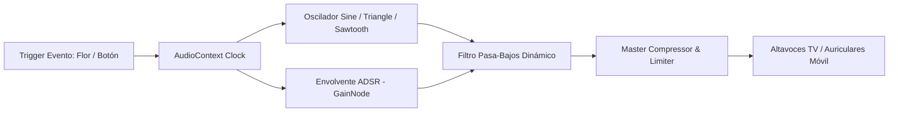

# AUDIO SPECIFICATION & SOUND DESIGN
# BeeStation: Misión Néctar

---

## 1. VISIÓN DEL PAISAJE SONORO (SOUNDSCAPE)

El audio de **Misión Néctar** equilibra la dulzura de un juego familiar con la gratificación auditiva de un arcade moderno.
- **Tonalidad General:** Mayor brillante (Pentatónica de Fa Mayor y Re Mayor), evocando luz matutina, optimismo y bienestar natural.
- **Instrumentación Simbolizada:** Marimbas de madera suave, campanas tubulares de cristal, pizzicatos de cuerdas cálidas, sintetizadores FM analógicos suaves y zumbidos musicales armónicos.
- **Accesibilidad Sensorial:** Todo evento sonoro tiene su duplicado visual inmediato (texto flotante, sacudida de pantalla o destello) para garantizar accesibilidad en entornos feriales ruidosos o para personas con discapacidad auditiva.

---

## 2. ARQUITECTURA TÉCNICA: SÍNTESIS PROCEDURAL WEB AUDIO API

Para eliminar completamente el riesgo de descargas fallidas, latencias de buffer o bloqueos por CORS de archivos MP3 en ferias con WiFi inestable, el juego incorpora un **Motor de Audio Sintetizado en Tiempo Real** utilizando nodos nativos de `AudioContext` de HTML5 (`OscillatorNode`, `GainNode`, `BiquadFilterNode`):

---

## 3. ESPECIFICACIÓN DE EFECTOS SONOROS (SFX)

| ID de Evento | Nombre del Efecto | Tipo de Onda | Frecuencias / Envolvente | Sensación Psicoacústica |
|---|---|---|---|---|
| `SFX_POP_NECTAR` | Toque de Flor Común | `sine` pura | 523.25 Hz (C5) -> 659.25 Hz (E5). Envolvente de decaimiento: Attack 5ms, Decay 120ms. | Gota dulce que salta, satisfacción inmediata. |
| `SFX_GOLDEN_LOTUS`| Cosecha Flor Dorada | Multi-oscilador `sine` + `triangle` | Tríada armónica: 880 Hz (A5), 1108.7 Hz (C#6), 1318.5 Hz (E6). Arpegio veloz de 40ms. | Brillo mágico celestial, recompensa mayor. |
| `SFX_COMBO_UP` | Multiplicador de Racha | `triangle` con modulación FM | Tono ascendente de 440 Hz a 880 Hz con trémolo suave de 12 Hz. | Adrenalina de aceleración y maestría táctil. |
| `SFX_COUNTDOWN_TICK`| Tic de 3-2-1 | `sine` percusivo | 440 Hz (La4), pulso limpio de 80ms. | Concentración y anticipación antes del inicio. |
| `SFX_COUNTDOWN_GO` | ¡A Volar! (Inicio) | Acorde mayor abierto | 523.25 Hz (C5) + 659.25 Hz (E5) + 783.99 Hz (G5) + 1046.5 Hz (C6). | Euforia, señal de largada enérgica. |
| `SFX_HIVE_FILL` | Impacto en Colmena | `sine` filtrado bajo | 180 Hz resonante con decaimiento suave de 250ms. | Sensación de densidad y peso de miel acumulada. |
| `SFX_VICTORY_FANFARE`| Colmena 100% / Fin | Fanfarria arpegiada | Secuencia penta: C5 - E5 - G5 - A5 - C6 - E6 en ráfaga ascendente y acorde final sostenido. | Triunfo compartido, orgullo de equipo. |
| `SFX_BEE_BUZZ` | Zumbido Ambiental | Modulador FM dual | 220 Hz a 250 Hz (frecuencia biológica real de las alas de la abeja melífera) con LFO a 6 Hz. | Conexión orgánica con el insecto real. |

---

## 4. BUCLE MUSICAL GENERATIVO (CHILL ARCADE GARDEN THEME)

El prototipo incluye una pista ambiental generativa sintetizada en bucle que combina acordes suaves de fondo con notas de marimba en tempo ferial animado (112 BPM):
- **Estructura Armónica (Progresión):**
  - Compás 1: Fa Mayor 7 (`F - A - C - E`) — Bienestar y frescura.
  - Compás 2: Sol Mayor con novena (`G - B - D - A`) — Esperanza y vuelo.
  - Compás 3: Mi menor 7 (`E - G - B - D`) — Calidez vegetal.
  - Compás 4: La menor 7 a Re menor (`A - C - E - G` -> `D - F - A - C`) — Cadencia cíclica perfecta.
- **Aceleración Dinámica:** En los últimos 10 segundos de la partida, el tempo de la música se incrementa automáticamente a 132 BPM y se agrega un redoble rítmico que eleva la emoción colectiva.
