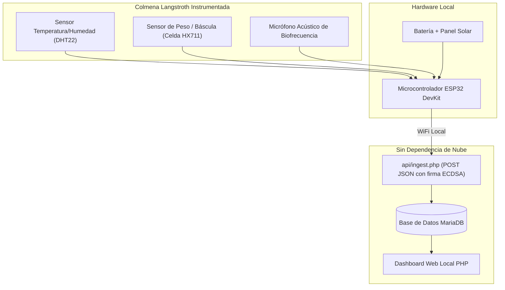

# BEESTATION BRIDGE & TELEMETRÍA EDUCATIVA
# BeeStation: Misión Néctar

---

## 1. PROPÓSITO DEL PUENTE NARRATIVO Y EDUCATIVO

En las ferias científicas y eventos del **SENA Centro Minero Ambiental**, el videojuego cumple una doble función estratégica:
1. **Fase Lúdica (Misión Néctar):** Atraer a las familias, niños y jóvenes mediante una experiencia cooperativa vibrante y accesible.
2. **Fase Pedagógica y de Impacto (BeeStation IoT):** Transformar la emoción del juego en curiosidad científica genuina por la protección de las abejas y la tecnología aplicada a la apicultura.

Al concluir los 30 segundos de recolección y celebrarse el néctar cosechado, Mielita se dirige al público en el televisor con una pregunta reflexiva que conecta ambos mundos:

> **MIELITA:**  
> *"¡Miren cuánta miel logramos reunir juntos! Pero... en la naturaleza real, ¿cómo podemos saber si nuestras abejas están sanas y tienen suficiente alimento sin tener que abrir la colmena e interrumpir su trabajo?"*  
> *(La pantalla del televisor realiza una transición estilo "Escáner Tecnológico": la ilustración del jardín se desvanece suavemente para revelar el corte transversal de una colmena Langstroth instrumentada con sensores IoT)*  
> **MIELITA:**  
> *"¡Con BeeStation! Un nodo inteligente con tecnología ESP32 que escucha, pesa y monitorea el nido en tiempo real sin molestar a una sola abeja."*

---

## 2. ARQUITECTURA TÉCNICA REAL DE BEEStation (SENA CENTRO MINERO AMBIENTAL)

Para garantizar total fidelidad con el proyecto institucional original, las variables y componentes representados en el juego corresponden exactamente a la ingeniería del sistema BeeStation:

---

## 3. VARIABLES DE TELEMETRÍA Y SU SIGNIFICADO BIOLÓGICO

En el módulo interactivo de demostración de BeeStation integrado en el prototipo, se presentan las 4 variables clave del sistema:

| Variable Medida | Sensor de Hardware | Rango Normal Saludable | Significado Biológico en la Colmena |
|---|---|---|---|
| **Temperatura de Cría** | Sensor DHT22 / Sonda DS18B20 | **34.5 °C a 35.5 °C** | Las abejas mantienen esta temperatura constante batiendo sus alas para calentar o evaporar agua para enfriar el nido. Variaciones bruscas indican debilidad de la colonia. |
| **Humedad Relativa** | Sensor DHT22 | **55 % a 65 %** | Esencial para que la miel no fermente y las larvas no se deshidraten. |
| **Peso Total de la Colmena**| Celda de carga 200kg + amplificador HX711 | **40.0 kg a 48.5 kg** (ejemplo en alza) | Permite al apicultor conocer con precisión cuántos kilogramos de néctar ingresan en cada jornada sin abrir el cajón. |
| **Actividad Acústica (FFT)**| Micrófono electret + análisis de frecuencia | **Pico central: 200 Hz a 250 Hz** | Un zumbido a 240Hz representa colonia tranquila con reina activa. Un pico anómalo a >450Hz alerta de posible enjambrazón o pérdida de la reina. |

> [!NOTE]  
> En el prototipo interactivo, todas las gráficas y lecturas se rotulan explícitamente como **"DATOS DE DEMOSTRACIÓN SIMULADOS"**, manteniendo la rigurosidad científica exigida y respetando la separación del repositorio central de BeeStation.

---

## 4. PANTALLAS DEL MÓDULO INTERACTIVO DE TELEMETRÍA

1. **Vista de Corte Transversal de la Colmena:** Un gráfico vectorial estilizado donde se iluminan los puntos exactos de instalación de los sensores dentro de la cámara de cría y bajo el fondo de la colmena.
2. **Dashboard de Telemetría en Vivo (Demo):** Cuatro tarjetas con indicadores analógicos/digitales animados:
   - Tarjeta Temperatura: Indicador circular con termómetro verde.
   - Tarjeta Humedad: Gota de agua estilizada con porcentaje dinámico.
   - Tarjeta Peso: Báscula con curva de ganancia diaria tras la cosecha de Misión Néctar.
   - Tarjeta Acústica: Visualizador de espectro de audio (ondas sonoras oscilando suavemente a 240 Hz).
3. **Píldora Educativa Interactiva:** Los asistentes pueden mover un deslizador de "Hora del día" para ver cómo a las 10:00 a.m. las abejas salen al campo (el peso baja un poco) y a las 4:00 p.m. regresan cargadas de néctar (el peso sube).
